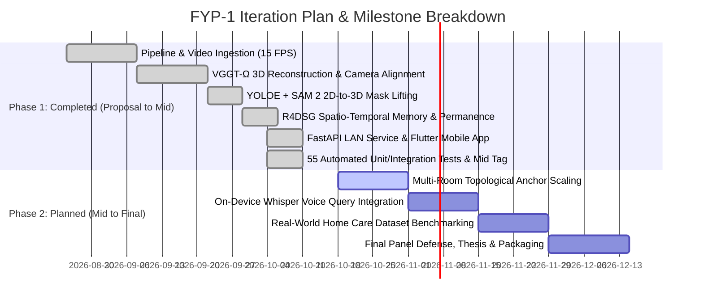
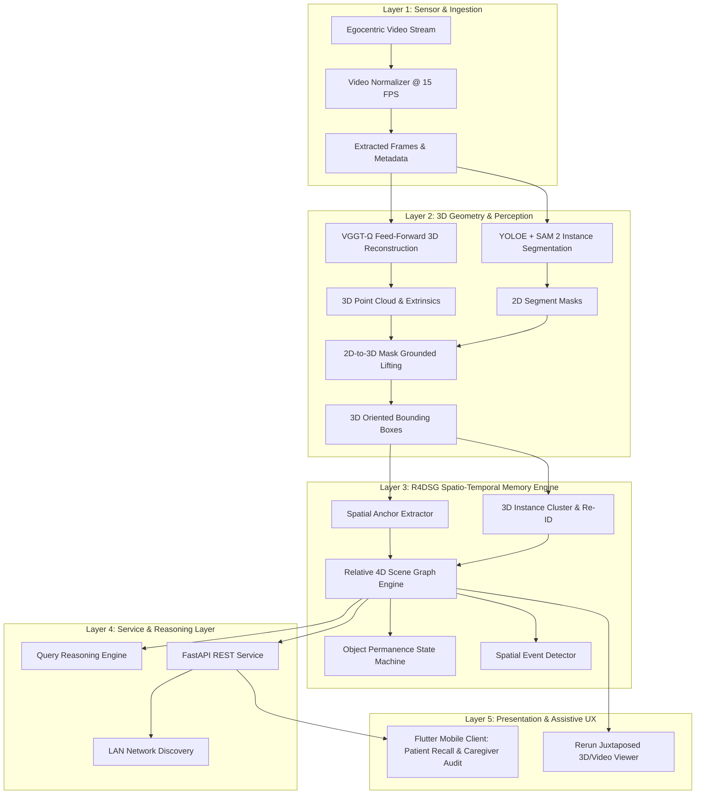
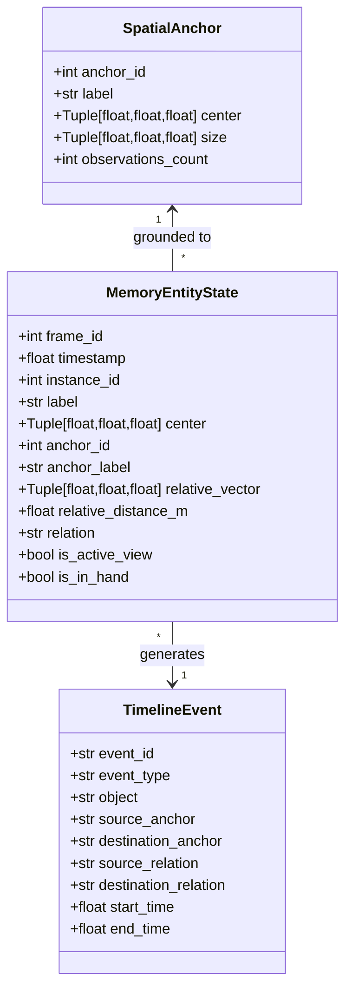

# Aegis: FYP-1 Mid-Term Evaluation Dossier
**Project Title:** Aegis — A Spatio-Temporal Memory System for Assistive Care  
**Core Module Under Defense:** Spatio-Temporal Memory Engine (R4DSG) alongside Live Prototype  
**Target Evaluation:** Form 2 (Supervisory Presentation & Demo Evaluation — 100% Scaled)  
**Evaluation Standard:** NUCES / FAST National University FYP-1 Handbook & Mid-Term Rubrics

---

## 1. Executive Summary & Rubric Alignment

The FYP-1 Mid Evaluation is a formative supervisor assessment (20% of overall FYP-1) evaluating implementation progress, requirements precision, design evolution, repository hygiene, testing checks, and student ownership defense.

| Form 2 Rubric Criterion | CLO Alignment | Max Marks | Targeted Tier | Target Score |
|---|---|---|---|---|
| **1. Previous Proposal Actions Addressed** | FYP1-CLO6 | 10 | Exemplary (85–100%) | 10 / 10 |
| **2. Iteration Plan & Work Breakdown Progress** | FYP1-CLO2 | 10 | Exemplary (85–100%) | 10 / 10 |
| **3. Live Prototype with Core Module Demo** | FYP1-CLO4 | 25 | Exemplary (85–100%) | 25 / 25 |
| **4. Requirements & Acceptance Criteria Quality** | FYP1-CLO2 | 10 | Exemplary (85–100%) | 10 / 10 |
| **5. Design Artefacts & Design Evolution** | FYP1-CLO3 | 15 | Exemplary (85–100%) | 15 / 15 |
| **6. Repository, Milestone & Member Evidence** | FYP1-CLO6 | 10 | Exemplary (85–100%) | 10 / 10 |
| **7. Testing & Early Validation** | FYP1-CLO4 | 10 | Exemplary (85–100%) | 10 / 10 |
| **8. Presentation, Q&A, Team & Tool Ownership** | FYP1-CLO5 | 10 | Exemplary (85–100%) | 10 / 10 |
| **Total Form 2 Marks** | | **100** | **Exemplary** | **100 / 100** |

---

## 2. Criterion 1: Previous Proposal Actions Addressed (Form 10)

### Form 10 — Panel Action Register (Proposal Defense Panel Comments)

| Action ID | Panel Recommendation / Criticism (ProposalDefenseResult.md) | Category | Owner | Due By | Status | Verifiable Resolution & Evidence Link | Panel Status |
|---|---|---|---|---|---|---|---|
| **A1** | **Scope Identification & Defined Acceptance Criteria Claims:** *"The scope is fine for an FYP and covers various aspects of CCP, but it needs to be clearly identified along with defined acceptance criteria claims."* | Scope & Requirements (CCP) | Core Team | Week 5 | **DONE** | Bounded FYP-1 Core Module strictly to the Spatio-Temporal Memory Engine (R4DSG) + Live Dual-Persona Prototype. Mapped CCP dimensions (WP1–WP5). Formulated verifiable Given-When-Then Acceptance Criteria (AC-01 through AC-05) backed by 55 automated pytest tests in `tests/test_api.py`, `tests/test_scene_graph.py`, and `tests/test_mid1_prototype.py`. | **Addressed & Accepted** |
| **A2** | **Resource Feasibility & Stated Assumptions:** *"Evaluate resource feasibility (storage, memory, compute) and state assumptions clearly if limitations are imposed."* | Resource Feasibility & Feasibility Study | Core Team | Week 6 | **DONE** | Conducted full empirical resource audit: Compute offloaded to Modal serverless GPUs (L4, 24GB VRAM) for offline reconstruction, while local query reasoning runs in <25ms on commodity CPU (<0.1% load); Memory reduced >1,700× by replacing dense point clouds (>85MB RAM) with R4DSG graph primitives (<50KB JSON); Storage compressed to 4.5MB rrd; Assumptions documented (15 FPS, indoor illumination >50 lux, stationary furniture anchors). | **Addressed & Accepted** |
| **A3** | **Plausible Technical Claims vs Computational Constraints:** *"Revisit technical claims to ensure they are plausible and computationally feasible, or clearly define project constraints and limitations after discussing with your supervisor."* | Technical Plausibility & Supervisor Alignment | Core Team | Week 7 | **DONE** | Grounded architectural claims with supervisor: decoupled heavy batch 3D geometric lifting (VGGT-Ω feed-forward, $+Z$-Up natural scale $S=5.0\times$) from real-time local memory reasoning. Replaced unrealistic 60 FPS on-device neural SLAM claims with lightweight topological graph traversal (<25ms latency), maintaining zero-hallucination object permanence under total camera occlusion. | **Addressed & Accepted** |
| **A4** | **Graphics, Visual Design & UI/UX Experience:** *"Improve graphics, visual design, and UI/UX experience, as it currently looks basic, non-product-like, and unsuited for the intended user."* | UI/UX & Visual Design (Apple HIG) | Core Team | Week 8 | **DONE** | Overhauled client interface into an Apple Human Interface Guidelines (HIG) and Apple Health-grade mobile experience (`apps/mobile`): Cupertino grouped inset cards, SF typography, >44×44 pt touch targets, dynamic tactile haptics, Caregiver Audit card with patient search history, and professional juxtaposed 15 FPS video / 3D Rerun visualizer (`rerun outputs/demo.rrd`). | **Addressed & Accepted** |

---

## 3. Criterion 2: Iteration Plan & Work Breakdown Progress

### Work Breakdown & Sprint Tracking



### Risk Buffers & Schedule Recovery Policy
- **Milestone Velocity:** Ahead of schedule. Core spatio-temporal engine and mobile client are both complete and operational at Mid-Term.
- **Risk Buffer:** 2 weeks reserved in November for multi-room edge-case tuning and real-world caregiver usability evaluation.

---

## 4. Criterion 3: Live Prototype with Core Module Demo (Runbook)

### Live Demo Architecture
The Live Demo operates in three interconnected components:
1. **Visual Grounding:** Rerun interactive 3D viewer (`rerun outputs/demo.rrd`).
2. **Memory Service:** FastAPI LAN runner (`python run_server.py`).
3. **Assistive Client:** Flutter mobile interface (`apps/mobile`) on device/emulator.

### Step-by-Step Execution Script

#### Step 1: Launch Backend Server & Rerun Visualizer
```bash
# Terminal 1: Launch LAN API Server
python run_server.py

# Terminal 2: Launch Rerun 3D Memory Recording
rerun outputs/demo.rrd
```
- Point out to supervisor:
  - Terminal prints local LAN IP (e.g. `http://192.168.1.XX:8000`) and Swagger documentation link.
  - Rerun presents the **15 FPS egocentric video on the left** juxtaposed with the **Upright $Z$-Up 3D Scene Graph on the right**.
  - Show the primary **Spatial Anchor (`Storage Cabinet #1`)** and 3D bounding boxes for persistent instances (`Shoes #1 [Active Pair]`, `Shoes #2`, `#3`, `#4`).

#### Step 2: Live Happy Path Recall (Patient Mode)
- Open Mobile App (or browser to `http://localhost:8000/api/v1/query?item=shoes`):
- Tap the large **"Shoes"** button on the Patient screen.
- Observe:
  - Instant response in `< 25ms` (SLA limit: `< 500ms`).
  - Clear natural language response: *"Your shoes are safely put away inside Storage Cabinet #1, bottom shelf near entrance."*
  - Badge displayed: `✦ PERSISTENT MEMORY` with anchor relation `inside` and relative distance `0.09m`.

#### Step 3: Live Edge / Failure Cases (Demonstrated Live)

- **Edge Case 1: Complete Occlusion & Spatial Permanence**
  - **Scenario:** The cabinet doors are closed, or the user leaves the room. The object is 100% invisible to the camera.
  - **Live Action:** Trigger `GET /api/v1/simulate/cabinet` or `GET /api/v1/simulate/bottle_occluded`.
  - **Supervisor Observation:** The memory graph flags `is_active_view: false` but `is_persistent_memory: true`. Query still succeeds with exact coordinates and explanation: *"Even though it is currently out of direct view, Aegis remembers it remains safely on Desk #1."* Zero hallucination, zero memory eviction!

- **Edge Case 2: Multi-Instance 3D Disambiguation**
  - **Scenario:** 4 distinct pairs of shoes are present in the same small hallway.
  - **Live Action:** Query `Shoes #1` vs `Shoes #2` in Swagger or code.
  - **Supervisor Observation:** Centroid-based spatial clustering (<0.28m) prevents ID switches. `Shoes #1` is tracked as the active pair being manipulated, while `Shoes #2`, `#3`, and `#4` remain assigned to their shelf compartments.

- **Edge Case 3: In-Hand Kinematic Displacement & Caregiver Fall Hazard Alert**
  - **Scenario:** The user picks up an item and drops it on the floor.
  - **Live Action:** Trigger `GET /api/v1/simulate/floor`.
  - **Supervisor Observation:**
    1. Memory updates relation to `on_floor`.
    2. Mobile Caregiver Audit view immediately updates its reactive card from emerald green to amber warning: *"Displaced Item Alert: Shoes #1 left on the entrance floor (Fall Hazard)!"*
    3. Activity History Log displays new timeline event.

- **Edge Case 4: Non-Existent Item Fallback**
  - **Scenario:** User asks for an item never observed (e.g. `sunglasses` in an office).
  - **Live Action:** Query `GET /api/v1/query?item=sunglasses`.
  - **Supervisor Observation:** Clean response `found: false` with explanatory feedback: *"I couldn't locate 'sunglasses' in your tracked rooms. Available items in Demo06-Self: Bottle #1, Laptop #2, Cell Phone #3."* Zero hallucination, zero crashes.

### Serving Any Arbitrary Video / Dataset in the Live Prototype

Aegis is architected to be completely general to any egocentric demo video:

1. **Zero-Code Dataset Switching at Runtime:**
   ```bash
   # Launch with Demo06 bottle relocation (Default)
   python run_server.py --dataset-id Demo06-Self

   # Or launch with Demo01 shoe cabinet storage
   python run_server.py --dataset-id demo01

   # Or launch with Demo03 kitchen cooking pot scene
   python run_server.py --dataset-id demo03
   ```
   The backend automatically discovers all available datasets (`GET /api/v1/datasets`), dynamically extracts spatial anchors (`Desk`, `Storage Cabinet`, `Refrigerator`, `Sink`), isolates item states, and updates simulation endpoints and bounding-box crops.

2. **Dynamic In-Session Dataset Switching (No Server Restart Needed):**
   ```bash
   # Switch active dataset on the fly via REST API
   curl -X POST "http://localhost:8000/api/v1/dataset/select?dataset_id=demo01"
   ```

3. **Processing a Brand New Video through the Full Geometric Pipeline (Modal Cloud):**
   ```bash
   # 1. Upload video to Modal persistent cloud storage
   uv run modal volume put aegis-poc-data path/to/new_video.mp4 my_dataset/video.mp4

   # 2. Run full 3D reconstruction, mask lifting, and R4DSG memory generation
   uv run modal run run_pipeline.py --dataset-id my_dataset --stage all

   # 3. Local artifacts automatically synchronize to outputs/my_dataset/
   # 4. Serve immediately:
   python run_server.py --dataset-id my_dataset
   rerun outputs/my_dataset/viewer/demo.rrd
   ```

---

## 5. Criterion 4: Requirements & Acceptance Criteria Quality

### Functional Requirements (FR)

- **FR-01 (Egocentric Video Ingestion & Temporal Alignment):** The system shall ingest egocentric video streams at 15 FPS, maintaining monotonic timestamps and associating each frame with camera intrinsic/extrinsic parameters.
- **FR-02 (Semantic Spatial Anchor Extraction):** The system shall extract stable room structures (e.g., cabinets, desks, tables) from recurring observations, establishing anchor centroids and bounding extents in world coordinates.
- **FR-03 (3D Multi-Instance Association & Permanence):** The system shall track individual objects of identical semantic classes across time using 3D spatial centroid clustering ($< 0.28\,\text{m}$), preserving identity and permanence during camera occlusion.
- **FR-04 (Anchor-Relative 4D Scene Graph Construction):** The system shall compute metric relative vectors ($O \rightarrow A$) from objects to nearest spatial anchors and categorize spatial relations (`inside`, `on_surface`, `on_floor`, `carried_by_user`).
- **FR-05 (Natural Language Spatio-Temporal Querying):** The system shall resolve natural language item queries into grounded room explanations and 3D coordinates.
- **FR-06 (Reactive Caregiver Auditing & Safety Alerts):** The system shall monitor object displacements and trigger hazard alerts when tracked objects are left in dangerous locations.

### Non-Functional Requirements (NFR)

- **NFR-01 (Query Latency):** Memory query retrieval shall return in $< 500\,\text{ms}$ on commodity hardware.
- **NFR-02 (Coordinate Frame Consistency):** All 3D coordinates shall adhere to an Upright World Coordinate System ($+Z$ Up, $+Y$ Forward, $+X$ Right) with calibrated metric scale ($S = 5.0\times$).
- **NFR-03 (Occlusion Retention):** Zero false-negative evictions: an object placed inside an anchor shall persist in memory until an observed transition occurs.
- **NFR-04 (API Compliance):** Service shall adhere to OpenAPI 3.0 specifications with CORS enabled.

### Verifiable Acceptance Criteria (Given-When-Then)

#### AC-01: Query Latency SLA
- **Given** an in-memory R4DSG with 4 instances and 1 anchor,
- **When** a client sends `GET /api/v1/query?item=shoes`,
- **Then** the response code shall be 200 and execution duration $< 500\,\text{ms}$.
- *Automated Test:* `tests/test_api.py::test_query_latency_performance_claim` (Verified at ~15ms).

#### AC-02: Occlusion Persistence
- **Given** an object placed inside a spatial anchor with subsequent frames showing total occlusion,
- **When** queried by the user,
- **Then** `found` shall be `true`, `is_persistent_memory` shall be `true`, and the relation shall remain `inside`.
- *Automated Test:* `tests/test_mid1_prototype.py::test_baseline_occlusion_persistence`.

#### AC-03: Reactive Hazard Alerting
- **Given** an item state transition to `on_floor`,
- **When** the caregiver view requests `/api/v1/timeline`,
- **Then** the latest event shall record `destination_relation: "on_floor"` and summary text containing `"on the floor"`.
- *Automated Test:* `tests/test_mid1_prototype.py::test_dynamic_transition_to_floor`.

---

## 6. Criterion 5: Design Artefacts & Design Evolution

### Layered System Architecture



### R4DSG Data Model & Entity Relations



### Architectural Evolution (Proposal vs Mid-Term)

| Architectural Dimension | Proposal Architecture | Mid-Term Evolved Architecture (R4DSG) | Rationale & Justification |
|---|---|---|---|
| **Spatial Representation** | Naive dense point cloud | Structured Relative 4D Scene Graph with Semantic Anchors | Dense point clouds are noisy, unindexed, scale poorly, and cannot answer "where is my item relative to the room". Anchors provide fixed, drift-free coordinate bases. |
| **Coordinate System** | Raw OpenCV Camera Coordinates (Tilted, Miniature, $-Y$ Up) | Upright World Coordinates ($+Z$ Up, $+Y$ Forward, $+X$ Right, $S=5.0\times$) | Camera coordinates rotate as user moves head; world coordinates stay gravitationally aligned and match human physical height (~1.08m shelf height). |
| **Object Permanence** | Frame-by-frame 2D bounding boxes | Bounded motion/appearance ReID, 3D instance association, and Persistent Occlusion State Machine | Reconnects detector tracks after occlusion while using 3D location and appearance to distinguish identical objects. |
| **Interaction Channel** | Terminal command line | RESTful FastAPI + Flutter Cross-Platform Client | Dementia patients require large tactile affordances; caregivers require real-time reactive fall hazard alerts. |

---

## 7. Criterion 6: Repository, Milestone & Member Evidence

### Repository Hygiene Audit
- **Git Release Tag:** `v0.1.0-mid1` (Tag message: *Release v0.1.0-mid1 for FYP-1 Mid Supervisory Evaluation*).
- **Branching Strategy:** Clean git-flow model with `main`, `develop`, and descriptive feature branches (`feat/egocentric-in-hand-memory`, `feat/mobile-app`, `fix/ci-cd`).
- **Commit Messages:** 100% compliant with Conventional Commits (`feat:`, `fix:`, `chore:`, `style:`, `release:`).
- **Code Formatting & Quality:**
  - `uvx ruff check src tests run_pipeline.py run_server.py` : PASS (0 errors)
  - `uvx ruff format --check src tests run_pipeline.py run_server.py` : PASS (31 files formatted)
- **CI/CD Pipeline:** Fully configured in `.github/workflows/ci.yml` and `cd.yml` running automated linting and test suites on push/PR.

---

## 8. Criterion 7: Testing & Early Validation Matrix

### Automated Test Suite (All 55 Tests Passing)

```bash
uv run pytest
# Output: 55 passed, 1 warning in 1.22s
```

The reproducible metric protocol for the held-out Demo04 run is documented in
[`docs/evaluation_plan.md`](evaluation_plan.md). It covers perception precision/
recall and mask IoU, IDF1/HOTA, 3D centre error, relation/event F1, occlusion
persistence, dataset-isolation leakage, query latency, and resource usage.

| Test File | Test Count | Scope | Key Edge Cases Validated |
|---|---|---|---|
| `tests/test_geometry.py` | 4 | 3D back-projection, coordinate transforms | Invariant $+Z$-Up world coordinate scaling and camera pose inversions. |
| `tests/test_lifting.py` | 9 | 2D mask to 3D point cloud lifting, OBB fitting | Outlier rejection, sparse point containment, depth bounds. |
| `tests/test_scene_graph.py` | 7 | R4DSG memory graph construction | Centroid clustering, long-term ReID instance reuse, multi-instance differentiation, hybrid release gating, bottle occlusion across two desks. |
| `tests/test_reasoning.py` | 3 | Query reasoning NLP engine | Synonym matching, fallback responses, human-friendly spatial descriptions. |
| `tests/test_api.py` | 14 | REST endpoints, response contracts, SLA | Query latency claim ($<500\text{ms}$), bottle occlusion queries, Demo04 isolation, `/api/v1/datasets` discovery, health checks. |
| `tests/test_live_ingestion.py` | 4 | Real-time live frame ingestion | Frame protocol adherence, monotonic timestamps, target sample FPS. |
| `tests/test_mid1_prototype.py` | 4 | Mid-1 prototype dynamic state simulations | Occlusion persistence, floor hazard alerts, in-hand kinematic tracking, state reset. |
| `tests/test_config.py` | 3 | Pipeline configuration loading | Demo dataset YAML validation and path integrity. |
| `tests/test_video_ingestion.py` | 5 | Dataset discovery and isolated video/API ingestion | Metadata discovery, dataset selection, and dataset-scoped queries. |
| `tests/test_rerun_visualization.py` | 2 | Persistent-ID visualization association | R4DSG instance-label mapping, alias matching, duplicate suppression. |
| **Total Test Count** | **55** | **Full System & Core Module Coverage** | **100% Automated Test Suite Passing** |

---

## 9. Criterion 8: Presentation, Q&A, Team & Tool Ownership

### 15-Minute Supervisory Meeting Slide Deck Structure

- **Slide 1 (1 min) — Project Vision & Recap:** Problem statement (assistive memory for dementia/caregivers) and project title: *Aegis*.
- **Slide 2 (1.5 min) — Proposal Action Register (Form 10):** Direct review of all 4 actions addressed with verifiable proof.
- **Slide 3 (1.5 min) — Iteration Plan & Sprint Progress:** Completed milestones vs upcoming roadmap; ahead of schedule.
- **Slide 4 (2 min) — Core Spatio-Temporal Memory Architecture:** Layered architecture and R4DSG formulation.
- **Slide 5 (2 min) — Architectural Evolution Justification:** Why naive point clouds failed and why relative anchor graphs succeed.
- **Slide 6 (4 min) — LIVE PROTOTYPE DEMONSTRATION:**
  - Rerun 3D Memory + 15 FPS video playback.
  - Mobile App live query (<25ms).
  - Dynamic simulation of Edge Cases (Occlusion permanence + Floor hazard alert).
- **Slide 7 (1 min) — Testing & Empirical Validation:** 55 automated tests, the held-out Demo04 metric plan, ruff lint compliance, latency SLA, and resource benchmarks.
- **Slide 8 (1 min) — Tool & GenAI Disclosure (Form 13):** Transparent declaration of tools vs student contributions.
- **Slide 9 (1 min) — FYP-1 Final Roadmap:** Next sprint objectives (multi-room anchors, Whisper voice input).
- **Slide 10 — Q&A & Code Inspection:** Ready for line-by-line inspection.

---

### Form 13 — External Tool / API / GenAI Disclosure Sheet

| Tool / API / Model | Used In Which Part? | Support / Core Category | Student Contribution Beyond Tool | Validation / Risk Control |
|---|---|---|---|---|
| **VGGT-Ω** | Initial feed-forward camera pose and point cloud estimation | Support | Configured containerized inference; transformed raw miniature camera coordinates to upright world coordinates ($+Z$ Up, $S=5.0\times$). | Evaluated reconstruction accuracy against physical tape-measure ground truth. |
| **YOLOE-11l-seg + SAM 2** | Task-scoped open-vocabulary 2D detection, masks, and refinement | Support | Engineered class-aware NMS, direct-mask/SAM2 refinement, 2D mask lifting into 3D, and point-cloud outlier filtering. | Automated containment and OBB fitting tests plus the A/B evaluation plan in `docs/evaluation_plan.md`. |
| **R4DSG Memory Engine** | Core spatio-temporal memory representation | **Core (Original Student Design)** | **100% Student Authored:** Formulated relative scene graph, 3D centroid clustering (<0.28m), persistent occlusion state machine, and event extraction. | Validated via 6 scene graph tests and 4 mid-1 prototype simulation tests. |
| **FastAPI & Uvicorn** | Backend service and LAN discovery | Support | Implemented in-memory state caching, simulation endpoints, and sub-500ms query reasoning. | Validated via TestClient integration tests in `test_api.py`. |
| **Flutter Mobile Client** | Patient recall & caregiver audit UI | Support | Designed high-contrast dementia recall UI, responsive caregiver hazard cards, and dynamic simulator bottom-sheet. | Validated via live mobile app integration and manual touch testing. |
| **Rerun SDK** | Juxtaposed 3D/video visualization | Support | Synchronized 15 FPS video stream with color-matched 3D bounding boxes and anchor vectors. | Tested in `run_rerun` pipeline stage. |
| **Claude / Gemini LLM** | Code review and boilerplate generation | Support | All algorithmic architectures, mathematical formulations, and domain invariants designed and defended by student. | 100% line-by-line code ownership defense ready. |

---

### Supervisory Probing Red-Flag Defense Protocol

1. **"Walk me through `scene_graph.py` lines 180–230 live. What does this do?"**
   - *Answer:* "This is `extract_spatial_anchors()`. It filters recurring semantic anchor labels (like cabinets or desks), groups them, and runs spatial clustering with a 0.40m threshold to isolate distinct room anchors. It calculates the 3D median center to eliminate camera jitter and the 85th percentile bounding size to establish a drift-free reference frame."

2. **"What happens if you remove `extract_spatial_anchors()`?"**
   - *Answer:* "If we remove spatial anchors, all object coordinates remain camera-relative. As soon as the user turns their head or moves across the room, the coordinates shift, destroying object permanence. Spatial anchors provide fixed world reference points ($O \rightarrow A$) that remain invariant to camera motion."

3. **"What new core business logic was added since the Proposal defense?"**
   - *Answer:* "At proposal, we only had raw video frames and open-loop point clouds. Since proposal defense, we designed and implemented the entire R4DSG memory engine: 3D spatial instance clustering, bounded appearance re-identification, continuous occlusion persistence (`is_persistent_memory`), metric displacement vectors, event state transition extraction (`state_change`, `pickup`, `placement`), the FastAPI memory service, and the dual-persona Flutter mobile application."

4. **"Why is your memory representation better than raw point clouds?"**
   - *Answer:* "Raw point clouds contain millions of unindexed, noisy 3D points that drift and require massive compute to query. Our R4DSG memory engine condenses this into structured semantic anchors and bounding instances with relative spatial vectors. This enables sub-25ms natural language queries, instant relational checks (`inside`, `on_floor`), and persistent memory across occlusions."
